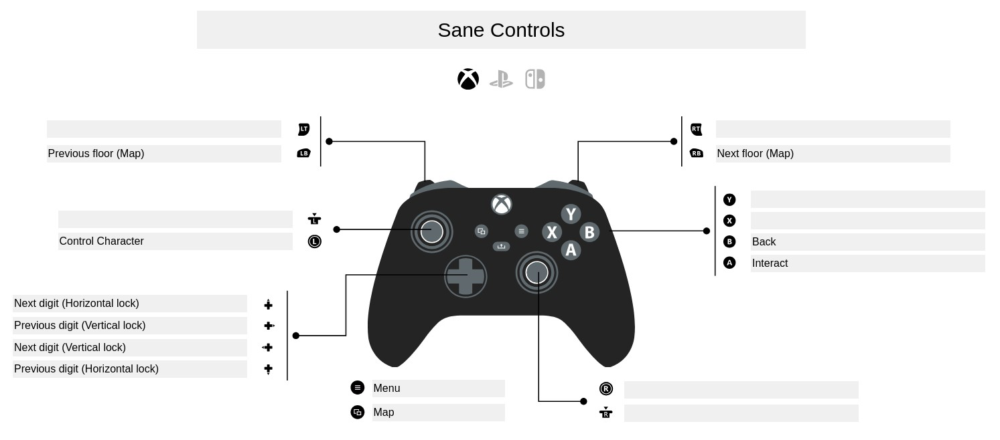
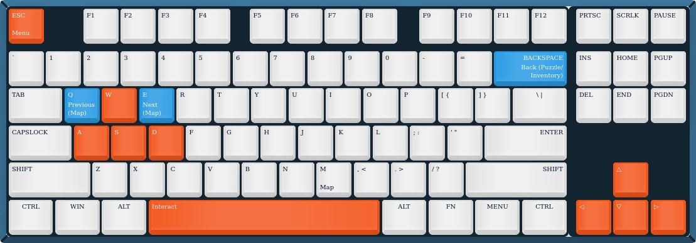

# Lorelei and the Sane Controls

https://github.com/user-attachments/assets/bec9f586-393c-4a85-9cc8-683cff3b5dce

This is a small mod for [Lorelei and the Laser Eyes](https://store.steampowered.com/app/2008920/Lorelei_and_the_Laser_Eyes/) that aims to somewhat improve the experience of navigating the numerous puzzles of The Letztes Jahr Hotel.

More specifically, it makes the following changes:
1. For simple (and most common) locks - padlocks, roman numeral locks, etc - the up 
and down button rotate the dials, and the "interact" button confirms the decision
2. It adds a new "Back" button (`B` on controllers and `Backspace` on keyboard) which lets you back out of puzzles and inventory screen
3. It adds a new "Map" button (`Select` on controllers and `M` on keyboard), which shows a map of the current floor (provided you have unlocked it in-game). Use `LB/RB` or `Q/E` to switch between floors. The shortcut also works in the maze and in the forest.

I didn't touch some of the more difficult locks (like the Red Maze Door), but most of my own gripes with the controls are solved now.
The Back button works in _most_ places, but not _everywhere_ (e.g. multiple choice dialog and free text input forms). Adding support for it involved a lot of ugly hacks and I've covered the most common/annoying screens.

# Mapping




# How to install

## On Windows

Download `Lorelei.zip` and `control_scheme_patcher.exe` from [Releases](https://github.com/graynk/LoreleiAndSaneControls/releases). Put both in the game's root directory, run the patcher and extract the zip file.

## On Steam Deck / Steam OS / Linux in general

The mod uses [BepInEx](https://docs.bepinex.dev/index.html) to inject the custom code, which in turn [relies](https://docs.bepinex.dev/articles/advanced/proton_wine.html) on `winhttp.dll` proxy DLL.
That means you have to do additional steps

1. Switch to Desktop Mode
2. Download `Lorelei.zip` and `control_scheme_patcher-linux`, put both in the game's root directory, run the patcher and extract the zip file.
3. Right click the game in Steam, open Properties, and set Launch Options to `WINEDLLOVERRIDES="winhttp=n,b" %command%`

## On Apple Silicon macOS

Frankly, I don't own a MacBook, so I don't know what's in vogue these days for playing Windows games. I do provide the native controls patcher just in case though.

## With latest BepInEx

`Lorelei.zip` already contains BepInEx in it and is meant for simple and quick installation. However, I can't constantly keep checking if everything still functions correctly (maybe some Windows or some Lorelei update will come out and break the injection, or maybe there are other mods you want to use, who knows).

If that's the case - you can manually install the latest BepInEx version and then my mod on top of it.

1. Download latest `BepInEx_win_x64` from [BepInEx releases page](https://github.com/BepInEx/BepInEx/releases)
2. Extract it into game's root directory
3. Launch the game once and close it
4. Download `Lorelei_minimal.zip` from [Releases](https://github.com/graynk/LoreleiAndSaneControls/releases)
5. Follow the instructions above for platform-specfic instructions (i.e. `control_scheme_patcher` and `WINEDLLOVERRIDES`).

## Custom stuff

The mod-specific bindings are embedded in the `control_scheme_patcher` already, but you can produce your own custom bindings (see [control_scheme_patch.json](./Patcher/Resources/control_scheme_patch.json) for an example) and apply them like this:

```text
control_scheme_patcher --patch my_bindings.json
```

Additionally, `control_scheme_patcher extract` extracts the full control scheme without modifying the game files.

# How to build it yourself

Install [.NET SDK](https://dotnet.microsoft.com/en-us/download).

## Mod DLL

1. Copy `Assembly-CSharp.dll` and `Rewired_Core.dll` from the game's `Lorelei and the Laser Eyes_Data/Managed` directory to `lib`.
2. Build the plugin:

   ```bash
   dotnet build --configuration Release --framework net46
   ```

3. Build the CLI:

   ```bash
   dotnet publish --configuration Release --framework net8.0
   ```

4. Copy `bin/Release/net46/LoreleiAndSaneControls.dll` to the game's `BepInEx/plugins` directory.
5. Copy `control_scheme_patcher` to the game's root folder and run it

## Tests

The tests require these local, .gitignored fixtures:

1. Copy `globalgamemanagers.assets` to `binds/globalgamemanagers_orig.assets`.
2. Copy `Assembly-CSharp.dll` and `Rewired_Core.dll` from the game's `Managed` directory to `lib`.
3. Put the patcher in the game root and run `control_scheme_patcher extract`.
4. Copy the extracted JSON to `binds/InputManager-globalgamemanagers.assets-orig.json`.

Run them with `dotnet test ControlSchemePatcher.Tests`.

# How to uninstall

1. Delete `BepInEx` folder and `winhttp.dll` from the game's root directory.
2. Verify the game's contents in Steam to restore original bindings (or use the .lorelei-backup file created by the patcher)

# Known problems

* The Map shortcut shows the map of the Hotel inside the Laser-1 prototypes and during the final sequence of the game, although it probably shouldn't. Not critical, not going to spend much time looking into it
* The Back button doesn't close the map screen opened by the Map shortcut. I've spent a _lot_ of time tracking this, and still couldn't figure out why it wasn't working - but you can still close it with the regular Interact button
